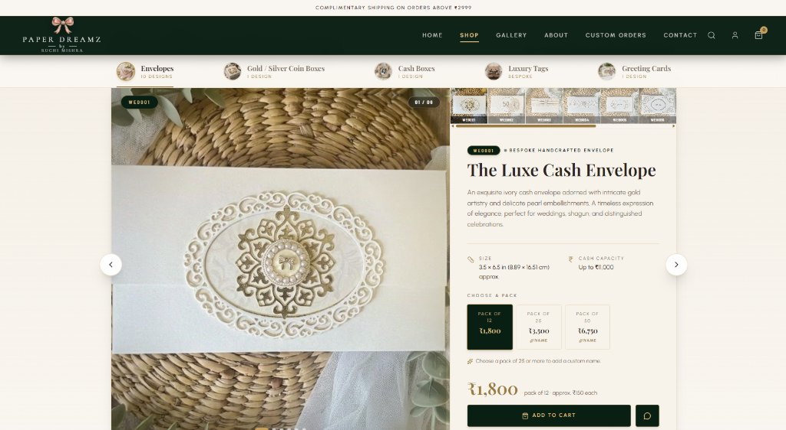

# Paper Dreamz 🎀

> **Luxurious creations, beautifully yours.**  
> A premium luxury e-commerce platform and 3D interactive showcase for bespoke handcrafted stationery, wedding cash envelopes, gold/silver coin boxes, keepsake gifts, and 3D celebration cards .

---

## 📸 Visual Previews

### 1. Brand Hero Showcase


### 2. Interactive 3D Product Stage & Editorial Range UI
*Featuring real-time 3D gyroscopic cursor tilt, camera trajectory motion, bespoke effect overlays, and inline full-height video showcase.*


### 3. Handcrafted Collections & Design Grid
*Browse collections with design codes, curated pack tiers, and live WhatsApp concierge enquiry.*


### 4. Shop by Category Showcase
*Editorial category slider highlighting bespoke craftsmanship across Envelopes, Coin Boxes, Keepsakes, Tags & Cards.*


---

## 🌟 Overview

**Paper Dreamz** is a modern, high-performance monorepo uniting an ultra-luxury editorial e-commerce frontend built with **Next.js 15, React 19, Three.js, and Framer Motion**, and a headless CMS backend powered by **Laravel 12 and Filament 3 Admin Panel**.

Designed with a high-fashion, boutique aesthetic (bottle green `#0a1f13`, brushed gold `#c5a059`, and ivory textures), the platform provides an interactive shopping experience featuring 3D gyroscopic tilt, camera trajectories, multi-angle product media, video showcases, and WhatsApp concierge ordering.

---

## ✨ Key Features

### 🛍️ Luxury Editorial Showcase & 3D Interactive Stage
- **Multi-Media Product Viewing**:
  - **✨ 3D Effect Mode**: Gyroscopic 3D cursor tilt tracking, dynamic continuous camera trajectories, spotlight torch, and bespoke handcrafted overlay effects (pearl gleams, gold wax seal shimmer, diamond prism, snowfall, dome sheen, nursery sparkle glints).
  - **📷 Simple Image Mode**: Pure high-resolution photograph view with real-time 3D spring hover tilt.
  - **▶ Showcase Video 1 & Video 2**: Full-bleed, edge-to-edge inline video players presenting artisanal craftsmanship without letterboxing.
- **Bespoke Product Ranges**:
  - *Wedding Envelopes* (`WE0001` - `WE0006`)
  - *Baby Envelopes & Baby Theme Coin Envelopes* (`BTCE0001` "Tiny Miracle")
  - *Luxury 3D Gifting Keepsake Cards* (`LGC001` Poinsettia, `LGC002` Wish Big Shaker Card)
  - *Gold & Silver Coin Boxes, Cash Boxes, Festive Envelopes & Luxury Tags*

### 🛒 Bespoke E-Commerce & Concierge Checkout
- **Pack & Pricing Engine**: Fixed luxury pack tiers (Packs of 1, 5, 10, 12, 25, 50) with automated per-piece pricing calculation.
- **Custom Name Personalization**: Custom name debossing/foiling inputs on packs of 25+ units.
- **Slide-Over Cart & Instant WhatsApp Concierge**: Instant cart drawer and direct WhatsApp integration pre-populated with design code, pack selection, custom names, and prices.

### ⚙️ Headless Laravel CMS & Filament 3 Admin
- **Filament Admin Panel** at `/admin` for real-time catalog and content management.
- **Manageable Content**: Collections, designs, sizes, pack tiers, story chapters, craft quotes, FAQs, value propositions, and customer enquiries.
- **Hybrid Data Layer**: High-speed static fallback catalog in TypeScript that seamlessly syncs with live Laravel REST APIs.

---

## 🏗️ Repository Architecture

```
Paper Dreamz/
├── docs/
│   └── screenshots/             # High-res preview screenshots for GitHub README
│       ├── hero.jpg
│       ├── product-stage.jpg
│       ├── collection-grid.jpg
│       └── categories.jpg
│
├── paper-dreamz-frontend/       # Next.js 15 App Router Frontend
│   ├── app/                     # Route handlers & layouts (Home, Shop, Gallery, Custom Orders)
│   ├── components/              # UI components, 3D stages, Cart, Navigation, Range Views
│   │   ├── ProductRangeAlt.tsx  # Editorial Split View with 3D Tilt, Video & Media Switcher
│   │   ├── ProductRange3DStore.tsx # Three.js WebGL Interactive Showroom
│   │   ├── CartDrawer.tsx       # Luxury slide-over shopping bag
│   │   └── ...
│   ├── lib/                     # Catalog types, seed data, cart store, API clients
│   └── public/                  # High-res WebP/JPG product photography, showcases & videos
│
├── paper-dreamz-backend/        # Laravel 12 API + Filament 3 CMS
│   ├── app/                     # Models, Controllers, Filament Resources
│   ├── database/                # Migrations, seeders, and SQLite/MySQL schema
│   ├── routes/                  # API endpoints and admin routes
│   └── ...
└── README.md                    # Main monorepo documentation with live previews
```

---

## 🚀 Tech Stack

### Frontend
- **Framework**: [Next.js 15](https://nextjs.org/) (App Router, Turbopack)
- **UI Library**: [React 19](https://react.dev/)
- **Language**: [TypeScript 5](https://www.typescriptlang.org/)
- **Styling**: [Tailwind CSS v4](https://tailwindcss.com/)
- **3D & Graphics**: [Three.js](https://threejs.org/), [@react-three/fiber](https://docs.pmnd.rs/react-three-fiber), [@react-three/drei](https://github.com/pmndrs/drei)
- **Animation**: [Framer Motion](https://www.framer.com/motion/), [GSAP](https://gsap.com/)
- **Icons**: [Lucide React](https://lucide.dev/)

### Backend
- **Framework**: [Laravel 12](https://laravel.com/)
- **Runtime**: [PHP 8.4+](https://www.php.net/)
- **Admin CMS**: [Filament 3](https://filamentphp.com/)
- **Database**: MySQL / SQLite
- **API**: RESTful JSON API with CORS enabled

---

## 🛠️ Getting Started

### Prerequisites
- **Node.js** 20.x or higher
- **npm** or **pnpm**
- **PHP** 8.4+ and **Composer** (for backend)

---

### 1. Frontend Setup

```bash
cd paper-dreamz-frontend

# Install dependencies
npm install

# Configure environment
cp .env.example .env.local    # or configure NEXT_PUBLIC_API_URL

# Start development server
npm run dev
```

Open [http://localhost:3000](http://localhost:3000) to view the shop in your browser.

---

### 2. Backend Setup

```bash
cd paper-dreamz-backend

# Install PHP dependencies
composer install

# Configure environment
cp .env.example .env

# Generate application key & migrate database
php artisan key:generate
php artisan migrate --seed
php artisan storage:link

# Start local server
php artisan serve
```

Access the Filament Admin Panel at [http://localhost:8000/admin](http://localhost:8000/admin).

---

## 📦 Scripts

### Frontend
- `npm run dev` — Starts Next.js development server.
- `npm run build` — Compiles and optimizes for production.
- `npm run start` — Runs the compiled production build.
- `npm run lint` — Runs ESLint checks.

### Backend
- `php artisan serve` — Runs local Laravel development server.
- `php artisan migrate` — Runs database migrations.
- `php artisan db:seed` — Seeds default catalog & administrator credentials.

---

## 🔒 License & Copyright

Designed and developed for **Paper Dreamz**.  
All rights reserved © 2026.
