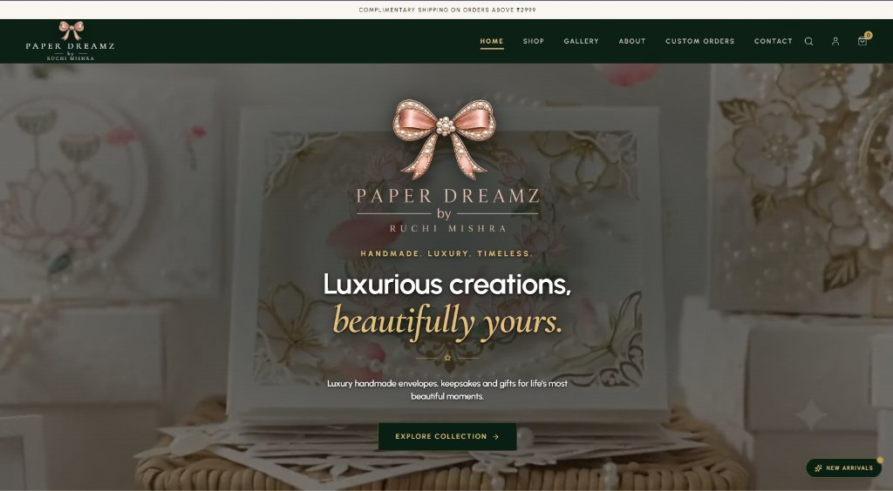
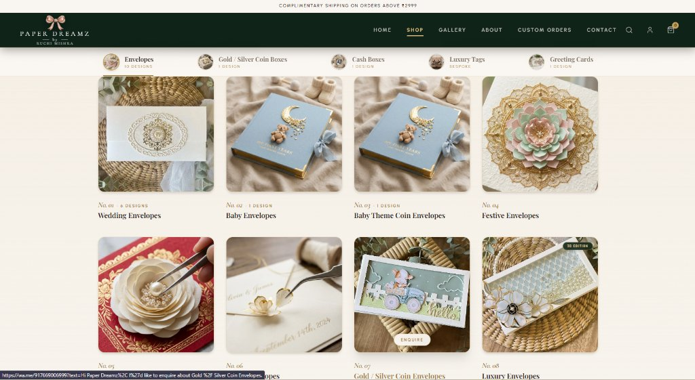
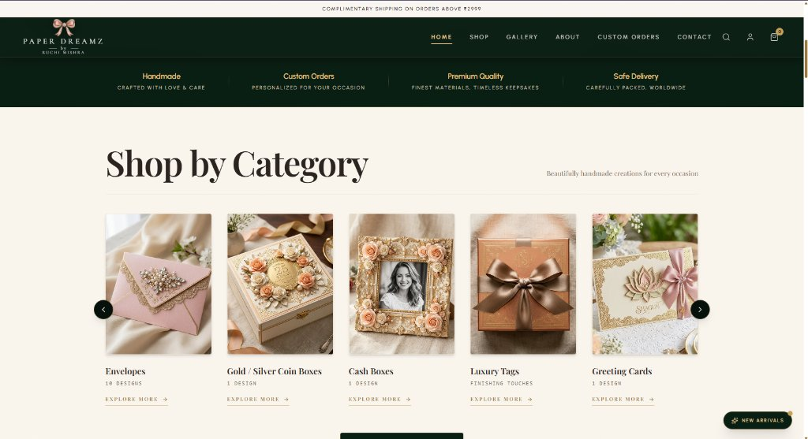

# Paper Dreamz — Luxury Frontend 🎀

> High-fashion boutique e-commerce frontend built with **Next.js 15**, **React 19**, **Three.js**, and **Tailwind CSS v4**.

---

## 📸 Visual Previews

### Hero & Brand Identity


### Interactive 3D Product Stage & Editorial Detail Panel


### Handcrafted Collections & Shop by Category
| Envelopes Collection Grid | Shop by Category Slider |
| :---: | :---: |
|  |  |

---

## ✨ Features

- **3D Interactive Product Range**:
  - Gyroscopic cursor-following 3D perspective tilt.
  - Bespoke visual overlays: Medallion gleam, Falling petals, Royal lace sheen, Diamond prisms, Shaker dome glass reflection, and nursery sparkle glints.
  - Multi-Media Switcher:
    - **✨ 3D Effect**: Dynamic motion trajectories and bespoke ambient light reflections.
    - **📷 Simple Image**: Pure high-definition still photograph with interactive 3D mouse hover tilt.
    - **▶ Showcase Video 1 & Video 2**: Edge-to-edge, full-height inline video players.
- **Bespoke Product Ranges**:
  - Wedding Shagun Envelopes (`WE0001` - `WE0006`)
  - Baby Keepsake Envelopes & Baby Theme Coin Envelopes (`BTCE0001` "Tiny Miracle")
  - Luxury 3D Gifting Cards (`LGC001` Christmas Poinsettia, `LGC002` Wish Big Shaker Card)
  - Gold & Silver Coin Boxes, Cash Boxes, Festive Envelopes & Luxury Tags
- **Shopping & Concierge**:
  - Fixed pack selector (Packs of 1, 5, 10, 12, 25, 50).
  - Custom name personalisation input for packs of 25+.
  - Slide-over cart and one-click WhatsApp concierge enquiry pre-filled with design details, pack size, custom names, and prices.

---

## 🛠️ Stack

- **Framework**: Next.js 15 (App Router, Turbopack)
- **Library**: React 19
- **Styling**: Tailwind CSS v4
- **Animation**: Framer Motion & GSAP
- **3D Graphics**: Three.js & @react-three/fiber
- **Icons**: Lucide React

---

## 🚀 Getting Started

```bash
# Install dependencies
npm install

# Start local development server
npm run dev
```

Visit [http://localhost:3000](http://localhost:3000) to view the application.

---

## 🏗️ Build & Deploy

```bash
# Production build
npm run build

# Start production server
npm run start
```
